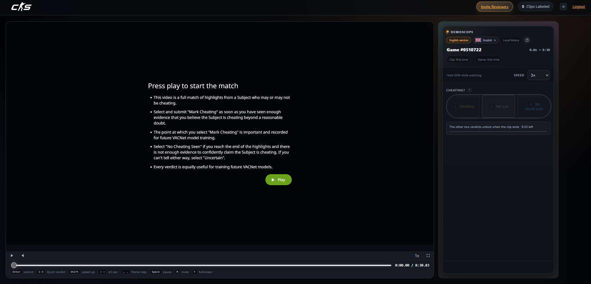

[English](https://github.com/ebayybe/DemoScope/blob/main/README/README.md) · [Български](https://github.com/ebayybe/DemoScope/blob/main/README/bg_README.md) · [Magyar](https://github.com/ebayybe/DemoScope/blob/main/README/hu_README.md) · [Tiếng Việt](https://github.com/ebayybe/DemoScope/blob/main/README/vi_README.md) · [Ελληνικά](https://github.com/ebayybe/DemoScope/blob/main/README/el_README.md) · [Dansk](https://github.com/ebayybe/DemoScope/blob/main/README/da_README.md) · **Bahasa Indonesia** · [Español (España)](https://github.com/ebayybe/DemoScope/blob/main/README/es-ES_README.md) · [Español (Latinoamérica)](https://github.com/ebayybe/DemoScope/blob/main/README/es-419_README.md) · [Italiano](https://github.com/ebayybe/DemoScope/blob/main/README/it_README.md) · [繁體中文](https://github.com/ebayybe/DemoScope/blob/main/README/zh-TW_README.md) · [简体中文](https://github.com/ebayybe/DemoScope/blob/main/README/zh-CN_README.md) · [한국어](https://github.com/ebayybe/DemoScope/blob/main/README/ko_README.md) · [Deutsch](https://github.com/ebayybe/DemoScope/blob/main/README/de_README.md) · [Nederlands](https://github.com/ebayybe/DemoScope/blob/main/README/nl_README.md) · [Norsk](https://github.com/ebayybe/DemoScope/blob/main/README/no_README.md) · [Polski](https://github.com/ebayybe/DemoScope/blob/main/README/pl_README.md) · [Português (Portugal)](https://github.com/ebayybe/DemoScope/blob/main/README/pt-PT_README.md) · [Português (Brasil)](https://github.com/ebayybe/DemoScope/blob/main/README/pt-BR_README.md) · [Română](https://github.com/ebayybe/DemoScope/blob/main/README/ro_README.md) · [Русский](https://github.com/ebayybe/DemoScope/blob/main/README/ru_README.md) · [ไทย](https://github.com/ebayybe/DemoScope/blob/main/README/th_README.md) · [Türkçe](https://github.com/ebayybe/DemoScope/blob/main/README/tr_README.md) · [Українська](https://github.com/ebayybe/DemoScope/blob/main/README/uk_README.md) · [Suomi](https://github.com/ebayybe/DemoScope/blob/main/README/fi_README.md) · [Français](https://github.com/ebayybe/DemoScope/blob/main/README/fr_README.md) · [Čeština](https://github.com/ebayybe/DemoScope/blob/main/README/cs_README.md) · [Svenska](https://github.com/ebayybe/DemoScope/blob/main/README/sv_README.md) · [日本語](https://github.com/ebayybe/DemoScope/blob/main/README/ja_README.md)

# DemoScope

[Features](#features) · [Installation](#instalasi) · [Shortcuts](#keyboard-shortcuts) · [Customization](#customization) · [Documentation](https://github.com/ebayybe/DemoScope/blob/main/docs/id_FUNCTIONS.md) · [Changelog](https://github.com/ebayybe/DemoScope/blob/main/CHANGELOG/id_CHANGELOG.md)

**Perangkat ulasan VACNet CS2 yang mengutamakan keyboard.** 
Preset keputusan · pemutar berbasis klip · tombol pintas yang dapat diatur · riwayat lokal privat · 29 bahasa.

[⬇ Pasang DemoScope](https://raw.githubusercontent.com/ebayybe/DemoScope/main/DemoScope.user.js)

## Tangkapan layar

<table><tr>
<td align="center" width="25%"> <b>Layar sambutan</b></td>
<td align="center" width="25%"> <b>Antarmuka utama</b></td>
    <td align="center" width="25%"> <b>Antarmuka peninjauan klip</b></td>
<td align="center" width="25%"> <b>Undang teman</b></td>
</tr></table>

## Ringkasan

DemoScope menyempurnakan halaman peninjauan Counter-Strike VACNet. Gunakan keyboard untuk menerapkan preset keputusan, menelusuri hanya segmen klip yang ditinjau, melangkah per frame, mempercepat sementara, mengirim dalam dua tahap, dan menyimpan riwayat privat keputusan Anda. Skrip mendukung formulir klasik empat pertanyaan dan tugas baru satu pertanyaan. Jika Valve mengubah halaman, skrip akan dinonaktifkan dengan aman. Semua berjalan lokal di browser.

## Fitur

| | |
|---|---|
| **Alur peninjauan** | Lima preset cepat pada tombol 1–5 dan 15 kombinasi tambahan. Pengacak keputusan opsional, nonaktif secara default. Enter menyiapkan pengiriman; Enter berikutnya mengirim. Esc membatalkan. |
| **Dua jenis tugas** | Mengenali formulir klasik (aim assist, wallhack, auto-bhop, bot) dan pertanyaan “Is the Subject cheating beyond a reasonable doubt?”. Tampilan tugas baru lebih ringkas, dengan label keputusan 1–3 dan indikator kunci yang menghitung mundur sampai klip berakhir. |
| **Pemutar berbasis klip** | Bilah pencarian dibatasi awal/akhir klip, lompatan ±5 detik, langkah frame 1/64 detik, peningkatan kecepatan dengan Shift (0,5×–4×), bisu dan layar penuh. |
| **Tombol pintas** | Atur ulang 18 tindakan di jendela khusus. Konflik dijelaskan sebelum diganti dan petunjuk tombol pada halaman mengikuti pengaturan Anda. |
| **Animasi** | Pratinjau langsung, enam gaya indikator, tiga kecepatan, dan sakelar. Mengikuti pengaturan pengurangan gerakan sistem secara default. |
| **Keputusan yang jelas** | Tanda “?” menjelaskan kategori keputusan; frasa penting disorot agar kata “tidak” tidak terlewat. |
| **Riwayat lokal privat** | Riwayat per klip dan game, impor/ekspor JSON, laporan HTML, dan penggabungan cadangan. |
| **Halaman undangan** | /vacnet/createinvite didesain ulang dengan tampil/sembunyikan, salin sekali klik, ringkasan persyaratan, tombol tutup, dan pintasan Enter/Esc. |
| **29 bahasa** | Mengikuti pilihan Anda, setelan Steam ?l=, lalu bahasa browser. Pilihan DemoScope juga mengganti teks VACNet. |
| **Efek suara** | Isyarat Web Audio sintetis dengan volume, pratinjau, dan sakelar. |
| **Tahan terhadap perubahan situs** | Langkah penyiapan terisolasi dan pencarian cadangan. Jika halaman tak dikenali, DemoScope nonaktif tanpa mengubah VACNet. Diagnostik dapat disalin untuk laporan bug. |

## Instalasi

1. Pasang [Tampermonkey](https://www.tampermonkey.net/) atau [Violentmonkey](https://violentmonkey.github.io/). Skrip menggunakan GM_addStyle dan unsafeWindow.
2. [Pasang DemoScope](https://raw.githubusercontent.com/ebayybe/DemoScope/main/DemoScope.user.js) dan konfirmasi di pengelola.
3. Masuk ke Steam dan buka [counter-strike.net/vacnet](https://www.counter-strike.net/vacnet/).
4. Buka klip peninjauan. Skrip berjalan otomatis; /vacnet/join tidak disertakan.

Pembaruan datang melalui pengelola userscript. DemoScope berfungsi di browser berbasis Chromium dan Firefox.

## Pintasan keyboard

Pintasan berfungsi saat fokus tidak berada di kolom yang dapat diedit atau kontrol interaktif lain. **Semua tombol dapat diubah di Pengaturan → Tombol pintas.**

| Tombol | Tindakan |
|---|---|
| 1–5 | Formulir klasik: preset bot + aim + wallhack, aim + wallhack, rage, pemain bersih, atau tidak yakin. |
| 1–3 | Tugas satu pertanyaan: Curang / Tidak yakin / Tidak melihat kecurangan. |
| Enter | Konfirmasi; formulir klasik memakai tekan pertama untuk menyiapkan dan tekan kedua untuk mengirim. |
| Esc | Batalkan keputusan tertunda atau batalkan persiapan Enter pertama. |
| Shift (tahan) | Kecepatan 0,5×–4×, standar 2×. |
| ← → | Lompat 5 detik mundur/maju. |
| , . | Mundur/maju satu frame (1/64 detik). |
| Space | Putar/jeda. |
| M / F | Bisu/layar penuh; klik ganda video juga mengganti layar penuh. |
| F2 | Buka pengaturan. |
| Enter / Esc (halaman undangan) | Selesai/tutup. |

## Kustomisasi

Buka pengaturan dengan F2. Tombol pintas dapat direset satu per satu atau sekaligus; konflik dapat diganti, ditukar, atau dibatalkan. Animasi menyediakan enam gaya dan tiga kecepatan. Efek suara dapat diaktifkan, diatur volumenya, dan diuji. Riwayat lokal memiliki batas dan ekspor JSON/HTML. Anda dapat menyembunyikan bagian footer. Diagnostik disalin untuk laporan masalah. Reset mengembalikan suara, tombol pintas, dan animasi; riwayat tetap disimpan.

## Bahasa

DemoScope menyediakan 29 bahasa: Bulgaria, Tionghoa Sederhana dan Tradisional, Ceko, Denmark, Belanda, Inggris, Finlandia, Prancis, Jerman, Yunani, Hungaria, Indonesia, Italia, Jepang, Korea, Norwegia, Polandia, Portugis (Portugal dan Brasil), Rumania, Rusia, Spanyol (Spanyol dan Amerika Latin), Swedia, Thai, Turki, Ukraina, dan Vietnam. Ganti kapan saja melalui pemilih bahasa di halaman.

## Melaporkan masalah

Valve dapat mengubah VACNet tanpa pemberitahuan. Tekan F2, buka **Diagnostik**, pilih **Salin diagnostik**, lalu tempelkan ke [issue baru](https://github.com/ebayybe/DemoScope/issues), sertakan tangkapan layar bila bisa. Laporan berisi versi, waktu, bahasa dan user-agent browser, elemen halaman yang ditemukan, langkah awal yang gagal, serta struktur halaman (tag, id, class), tetapi tidak memuat teks halaman, nama akun, atau riwayat. VACNet tetap berjalan normal jika DemoScope dinonaktifkan.

## FAQ

<b>Mengapa DemoScope dinonaktifkan di halaman ini?</b>

Halaman VACNet berubah dan tidak lagi dikenali. Skrip menonaktifkan diri agar halaman tidak tertinggal dalam keadaan setengah jadi. Salin diagnostik dan buat issue.

<b>Mengapa bahasa VACNet berbeda dari DemoScope?</b>

DemoScope meminta bahasa melalui parameter Steam ?l=. Jika VACNet tidak memiliki terjemahan itu, VACNet memakai bahasa defaultnya; label DemoScope tetap dalam bahasa pilihan Anda.

<b>Apakah DemoScope memilih keputusan untuk saya?</b>

Tidak. Preset hanya menekan tombol keputusan yang dipilih, dan Anda selalu mengonfirmasi pengiriman. Tinjau setiap klip sendiri dan ikuti aturan program.

<b>Apakah tugas satu pertanyaan dicatat?</b>

Belum. Riwayat lokal saat ini hanya dicatat untuk formulir klasik empat pertanyaan.

<b>Bagaimana mengembalikan tombol default?</b>

Gunakan ikon reset di samping tombol yang diubah, “Reset semua” di jendela tombol pintas, atau “Reset” di pengaturan.

## Arsitektur

DemoScope adalah satu fungsi mandiri yang berjalan pada document-start dan tidak berjalan di frame. init() memilih jenis halaman, memeriksa apakah halaman dikenali, lalu memasang modul. Referensi lengkap 217 fungsi tingkat atas, parameter, nilai balik, dan kunci penyimpanan ada di [id_FUNCTIONS.md](https://github.com/ebayybe/DemoScope/blob/main/docs/id_FUNCTIONS.md).

<b>Ikhtisar modul</b>

| Modul | Tanggung jawab | Fungsi utama |
|---|---|---|
| Localization | Bahasa UI, teks, bendera, pemilih bahasa, sinkronisasi ?l= VACNet | getActiveLocale, tr, settingText, syncSelectedLanguage, installLanguageSelector |
| Segment & player | Batas klip, pemutaran Video.js/HTML5, loop segmen situs | parseSegmentBounds, createPlayerAdapter, waitForPlayerAdapter, blockSegmentLoopGuard |
| Player enhancements | Bilah pencarian, petunjuk tombol, kecepatan, langkah frame | installCustomControls, installPlayerEnhancements |
| Hotkeys | Daftar tindakan, ikatan tombol, konflik dan jendela pintasan | getBinding, findKeyConflict, getActionForEvent, ensureHotkeysDialog |
| Verdict presets | Tabel preset dan status pilihan | applyPreset, detectActivePreset, buildEnhancementBar |
| Single-question task | Label, indikator kunci, tombol formulir baru | isCheatingMode, selectCheatingVerdict, updateCheatingLock |
| Submit flow | Konfirmasi dua tahap, batal, pengiriman | invokeProceedAction, invokeCancelAction, submitVerdictForm, finishSubmitLoadingWhenReady |
| Local history | Riwayat, cadangan, laporan | appendReviewHistory, importLocalHistory, exportCombinedHistoryReports |
| Settings & animations | Pengaturan, suara, animasi indikator | ensureSettingsDialog, installExtraSettingsSections, ensureAnimationsDialog, playUiSound |
| Invite page | Halaman undangan dan pintasan | installInvitePage, installInviteExtras |
| Resilience | Langkah terisolasi, fallback, penonaktifan, diagnostik | safeStep, disableDemoScope, buildDiagnosticsReport |
| Bootstrap | Titik masuk | init, enhanceLayout |

## Privasi

DemoScope tidak mengirim telemetri atau mengunggah pengaturan maupun riwayat. VACNet menerima keputusan melalui formulir normal situs. Data tetap di browser: localStorage (kunci berawalan demoscope) dan sessionStorage. Hapus riwayat melalui **Pengaturan → Riwayat lokal → Hapus riwayat**. Laporan diagnostik hanya disalin ke clipboard; Anda menentukan apakah akan membagikannya.

## Penafian

DemoScope adalah proyek komunitas tidak resmi, tidak berafiliasi dengan atau didukung Valve Corporation. Skrip tidak menentukan keputusan untuk Anda. Tinjau setiap klip sendiri dan ikuti aturan program. Gunakan dengan risiko sendiri.

## Lisensi

Dirilis di bawah lisensi [GNU GPL v3.0](https://github.com/ebayybe/DemoScope/blob/main/LICENSE).

## Ucapan Terima Kasih

- **Ide awal dan antarmuka dasar:** [*CS2 VACNet Review — Player & Layout Enhancements*](https://greasyfork.org/ru/scripts/591778-cs2-vacnet-review-player-layout-enhancements) oleh skinsales / goodvibes (MIT).
- **Konsep terkait dan fork berbahasa Rusia:** [*VACLens RU — CS2 Review Assistant*](https://greasyfork.org/ru/scripts/592414-vaclens-ru-cs2-review-assistant) oleh authorless (MIT).
- **Perombakan arsitektur, kerangka kerja yang dapat digunakan ulang, dukungan 29 bahasa, dan preset vonis khusus:** ebayybe.
