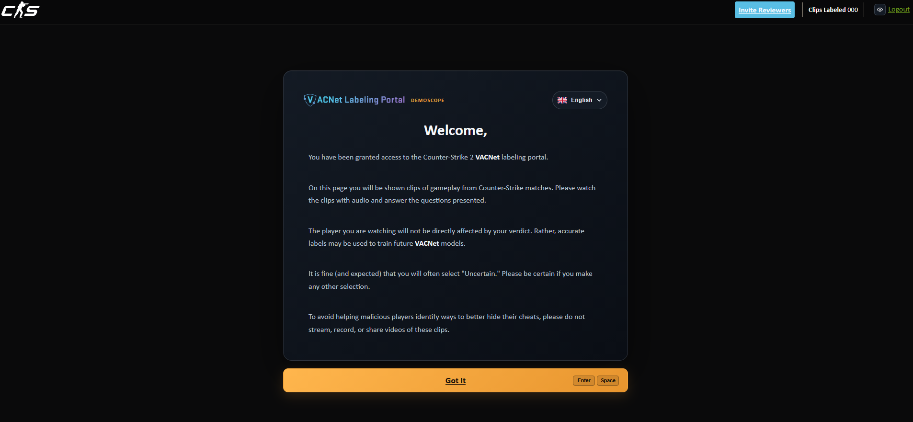
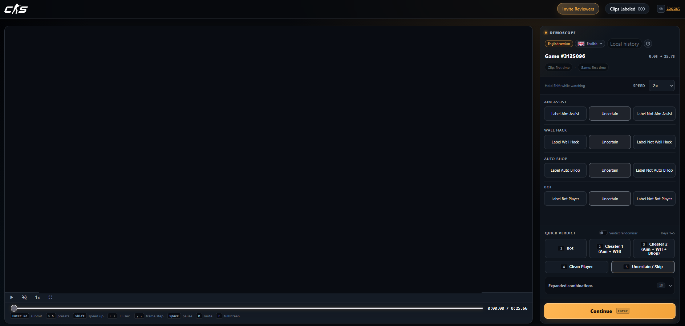
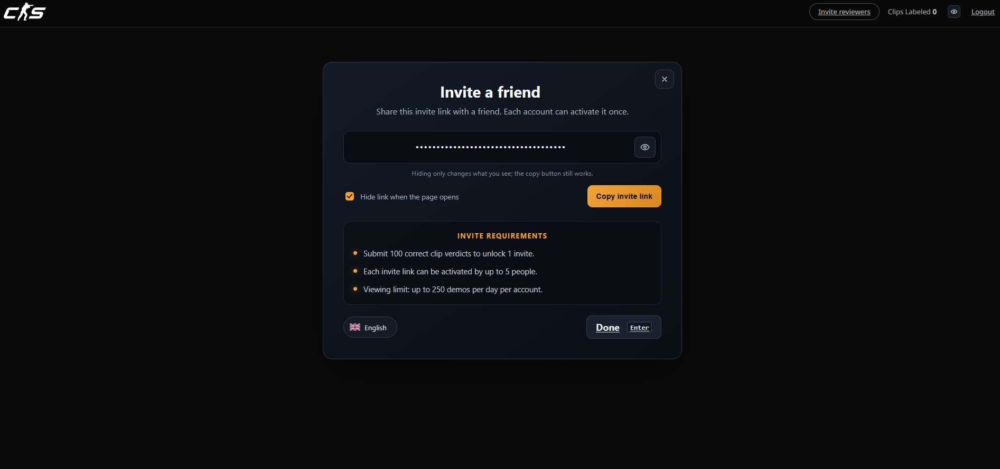

[English](https://github.com/ebayybe/DemoScope/blob/main/README/README.md) · [Български](https://github.com/ebayybe/DemoScope/blob/main/README/bg_README.md) · [Magyar](https://github.com/ebayybe/DemoScope/blob/main/README/hu_README.md) · [Tiếng Việt](https://github.com/ebayybe/DemoScope/blob/main/README/vi_README.md) · [Ελληνικά](https://github.com/ebayybe/DemoScope/blob/main/README/el_README.md) · [Dansk](https://github.com/ebayybe/DemoScope/blob/main/README/da_README.md) · [Bahasa Indonesia](https://github.com/ebayybe/DemoScope/blob/main/README/id_README.md) · [Español (España)](https://github.com/ebayybe/DemoScope/blob/main/README/es-ES_README.md) · [Español (Latinoamérica)](https://github.com/ebayybe/DemoScope/blob/main/README/es-419_README.md) · [Italiano](https://github.com/ebayybe/DemoScope/blob/main/README/it_README.md) · [繁體中文](https://github.com/ebayybe/DemoScope/blob/main/README/zh-TW_README.md) · [简体中文](https://github.com/ebayybe/DemoScope/blob/main/README/zh-CN_README.md) · [한국어](https://github.com/ebayybe/DemoScope/blob/main/README/ko_README.md) · [Deutsch](https://github.com/ebayybe/DemoScope/blob/main/README/de_README.md) · [Nederlands](https://github.com/ebayybe/DemoScope/blob/main/README/nl_README.md) · [Norsk](https://github.com/ebayybe/DemoScope/blob/main/README/no_README.md) · [Polski](https://github.com/ebayybe/DemoScope/blob/main/README/pl_README.md) · **Português (Portugal)** · [Português (Brasil)](https://github.com/ebayybe/DemoScope/blob/main/README/pt-BR_README.md) · [Română](https://github.com/ebayybe/DemoScope/blob/main/README/ro_README.md) · [Русский](https://github.com/ebayybe/DemoScope/blob/main/README/ru_README.md) · [ไทย](https://github.com/ebayybe/DemoScope/blob/main/README/th_README.md) · [Türkçe](https://github.com/ebayybe/DemoScope/blob/main/README/tr_README.md) · [Українська](https://github.com/ebayybe/DemoScope/blob/main/README/uk_README.md) · [Suomi](https://github.com/ebayybe/DemoScope/blob/main/README/fi_README.md) · [Français](https://github.com/ebayybe/DemoScope/blob/main/README/fr_README.md) · [Čeština](https://github.com/ebayybe/DemoScope/blob/main/README/cs_README.md) · [Svenska](https://github.com/ebayybe/DemoScope/blob/main/README/sv_README.md) · [日本語](https://github.com/ebayybe/DemoScope/blob/main/README/ja_README.md)

 

# DemoScope

**A ferramenta de revisão do CS2 VACNet pensada para o teclado.** 
Predefinições de vereditos · leitor adaptado aos limites dos clips · teclas configuráveis · histórico local privado · 29 idiomas.

 

 

[**⬇ Instalar DemoScope**](https://raw.githubusercontent.com/ebayybe/DemoScope/main/DemoScope.user.js)

[Funcionalidades](#funcionalidades) · [Instalação](#instalação) · [Atalhos de teclado](#atalhos-de-teclado) · [Personalização](#personalização) · [Documentação](https://github.com/ebayybe/DemoScope/blob/main/docs/pt-PT_FUNCTIONS.md) · [Registo de alterações](https://github.com/ebayybe/DemoScope/blob/main/CHANGELOG/pt-PT_CHANGELOG.md)

 

## Capturas de ecrã

<table>
  <tr>
    <td align="center" width="33%"> <b>Ecrã de boas-vindas</b></td>
    <td align="center" width="33%"> <b>Interface principal</b></td>
    <td align="center" width="33%"> <b>Convidar um amigo</b></td>
  </tr>
</table>

## Visão geral

O DemoScope melhora as páginas de revisão do Counter-Strike VACNet (`counter-strike.net/vacnet`). Em vez de percorrer o formulário de vereditos com cliques para cada clip curto, pode usar o teclado: predefinições de vereditos, barra de procura limitada ao segmento em revisão, avanço fotograma a fotograma, aceleração temporária, envio em dois passos e histórico privado dos seus vereditos. É compatível com os dois formulários atuais do VACNet (o clássico com quatro perguntas e a nova tarefa com uma pergunta) e protege-se quando a Valve altera a página. Tudo é executado localmente no seu navegador.

## Funcionalidades

| | |
|---|---|
| **Fluxo de revisão** | 5 predefinições rápidas de veredito em `1`–`5` e mais 15 combinações alargadas, aleatorizador opcional de vereditos (desativado por predefinição) e envio seguro em dois passos: `Enter` prepara o botão e outro `Enter` envia. `Esc` cancela. |
| **Ambos os tipos de tarefa** | Deteta o formulário clássico (assistência à mira, wallhack, auto-bhop, bot) e a tarefa de uma pergunta (“Is the Subject cheating beyond a reasonable doubt?”). Esta última usa um esquema compacto, vereditos identificados em `1`–`3` e um indicador bloqueado até ao fim do clip. |
| **Leitor adaptado ao clip** | Barra de procura e tempo limitados ao início e fim do clip, saltos de ±5 s, avanço de 1/64 s por fotograma, aceleração ao manter `Shift` premido (0,5×–4×), teclas para silenciar e ecrã inteiro. |
| **Atalhos configuráveis** | Reatribua qualquer uma das 18 ações numa janela própria. Os conflitos são explicados antes da substituição (ação, grupo e função) e todas as indicações de teclas na página seguem as suas definições. |
| **Animações** | Janela com pré-visualização em direto, seis estilos de indicador, três velocidades e um botão para ativar/desativar. Respeita por predefinição a opção do sistema «reduzir movimento». |
| **Vereditos claros** | Um botão «?» junto de cada categoria explica o seu significado; as expressões importantes são destacadas para que «not» não passe despercebido. |
| **Histórico local privado** | Histórico por clip e jogo em `localStorage`, importação e exportação JSON, relatórios HTML e junção de várias cópias de segurança num só relatório. |
| **Página de convite** | Página `/vacnet/createinvite` renovada, com mostrar/ocultar, cópia num clique, resumo dos requisitos, botão para fechar e atalhos `Enter` / `Esc`. |
| **29 idiomas** | Segue primeiro a sua escolha, depois a definição Steam `?l=` e, por fim, o idioma do navegador. Escolher um idioma no DemoScope também altera o texto do VACNet. |
| **Efeitos sonoros** | Sinais sintetizados com Web Audio, volume configurável, pré-visualização e botão para ativar/desativar. |
| **Preparado para alterações de design** | Os passos de configuração são isolados, os elementos importantes têm pesquisas alternativas e, se a página deixar de ser reconhecida, o DemoScope desativa-se sem alterar o VACNet. Um clique copia um relatório de diagnóstico para comunicar problemas. |

## Instalação

1. Instale um gestor de userscripts, como [Tampermonkey](https://www.tampermonkey.net/) ou [Violentmonkey](https://violentmonkey.github.io/). O script usa `GM_addStyle` e `unsafeWindow`.
2. [**Instale o DemoScope**](https://raw.githubusercontent.com/ebayybe/DemoScope/main/DemoScope.user.js) e confirme a instalação no gestor.
3. Inicie sessão no Steam e abra [counter-strike.net/vacnet](https://www.counter-strike.net/vacnet/).
4. Abra um clip de revisão. O DemoScope carrega automaticamente (a página `/vacnet/join` é excluída).

As atualizações chegam através do seu gestor de userscripts. O DemoScope funciona em navegadores baseados em Chromium e no Firefox.

## Atalhos de teclado

Os atalhos funcionam nas páginas de revisão quando o foco não está num campo editável ou noutro controlo interativo. **Todas as teclas abaixo podem ser alteradas** em **Settings → Hotkeys**.

| Tecla | Ação |
|---|---|
| `1` … `5` | Formulário clássico: aplicar uma predefinição (1 bot + mira + wallhack; 2 mira + wallhack; 3 rage; 4 jogador limpo; 5 incerto). |
| `1` `2` `3` | Tarefa de uma pergunta: Cheating / Not sure / No cheats seen. |
| `Enter` | Confirmar. No formulário clássico, premir uma vez prepara o botão; premir novamente envia. |
| `Esc` | Cancela o veredito à espera de confirmação ou desarma o primeiro `Enter`. |
| `Shift` (manter premido) | Aceleração (0,5×–4×; 2× por predefinição, selecionável na página). |
| `←` `→` | Retroceder / avançar 5 segundos. |
| `,` `.` | Retroceder / avançar um fotograma (1/64 s). |
| `Space` | Reproduzir / pausar. |
| `M` / `F` | Silenciar / ecrã inteiro (um duplo clique no vídeo também alterna o ecrã inteiro). |
| `F2` | Abrir a janela de definições. |
| `Enter` / `Esc` *(página de convite)* | Concluído / fechar. |

## Personalização

Abra as definições com `F2`. As secções estão ordenadas da mais utilizada para a menos utilizada:

- **Hotkeys**: janela própria com todas as ações agrupadas por finalidade, reposição individual, «Reset all» e gestão de conflitos com **Replace**, **Swap** ou **Cancel**. `Esc` pode ser atribuído como qualquer outra tecla.
- **Animations**: escolha um estilo (pulse, breathe, ripple, heartbeat, orbit, blink), uma velocidade ou desative as animações. Cada cartão mostra uma pré-visualização em direto.
- **Sound effects**: ativar/desativar, volume (também ajustável pela roda do rato) e botão de teste.
- **Local history**: ativar/desativar, limites (10/20/30/50 entradas por chave, 100/200/300/500 chaves), formato de 12/24 horas, cópias JSON e relatórios HTML.
- **Footer**: ocultar a ligação de feedback, a ligação do relatório, a linha de direitos de autor ou todo o rodapé.
- **Diagnostics**: copiar um relatório para comunicar problemas (ver [Comunicar um problema](#comunicar-um-problema)).
- **Reset**: um botão repõe os valores predefinidos do som, dos atalhos e das animações. O histórico é mantido.

## Idiomas

O DemoScope está disponível em 29 idiomas: búlgaro, chinês (simplificado e tradicional), checo, dinamarquês, neerlandês, inglês, finlandês, francês, alemão, grego, húngaro, indonésio, italiano, japonês, coreano, norueguês, polaco, português (Portugal e Brasil), romeno, russo, espanhol (Espanha e América Latina), sueco, tailandês, turco, ucraniano e vietnamita. Pode alterar o idioma a qualquer momento no seletor da página.

## Comunicar um problema

A Valve altera as páginas VACNet sem aviso. Se algo deixar de funcionar:

1. Prima `F2`, abra **Diagnostics** e clique em **Copy diagnostics**.
2. Cole o texto numa nova [issue](https://github.com/ebayybe/DemoScope/issues), juntamente com uma captura de ecrã, se possível.

O relatório contém a versão do script, a hora, o idioma e a identificação do navegador, os elementos de página encontrados, os passos de configuração que falharam e a estrutura da página (apenas tags, IDs e classes). Não contém texto da página, nome da conta nem histórico. Se a página deixar de ser reconhecida, o DemoScope desativa-se nessa página e informa-o; o VACNet continua a funcionar normalmente.

## Perguntas frequentes

<b>O DemoScope diz que foi desativado nesta página. O que aconteceu?</b>

A página VACNet já não corresponde ao que o DemoScope espera, por isso o script interrompeu a sua execução em vez de deixar uma interface incompleta. Copie o diagnóstico (ver acima) e abra uma issue; normalmente uma atualização chega rapidamente.

<b>O texto dos vereditos VACNet está noutro idioma que não o do DemoScope.</b>

Ao escolher um idioma no DemoScope, o VACNet é solicitado nesse idioma através do parâmetro Steam `?l=`. Se o VACNet não tiver tradução, utiliza o seu idioma predefinido, enquanto os rótulos do DemoScope permanecem no idioma escolhido.

<b>O DemoScope escolhe os vereditos por mim?</b>

Não. As predefinições apenas clicam nos botões que escolheu e é sempre você que confirma o envio. Reveja cada clip e siga as regras do programa.

<b>O histórico é guardado na tarefa de uma pergunta?</b>

Ainda não. Atualmente, o histórico local é guardado apenas para o formulário clássico de quatro perguntas.

<b>Como restauro as teclas predefinidas?</b>

Use o ícone de reposição junto de uma tecla alterada, **Reset all** na janela Hotkeys ou **Reset** nas definições; esta última opção também repõe o som e as animações.

## Arquitetura

O DemoScope é uma única função autoexecutável (`@run-at document-start`, `@noframes`). `init()` identifica o tipo de página, verifica se é reconhecível e inicializa os módulos abaixo. A referência completa das 217 funções de nível superior, incluindo parâmetros, valores devolvidos e chaves de armazenamento, está em [pt-PT_FUNCTIONS.md](https://github.com/ebayybe/DemoScope/blob/main/docs/pt-PT_FUNCTIONS.md).

<b>Visão geral dos módulos</b>

| Módulo | Responsabilidade | Funções principais |
|---|---|---|
| `Localization` | Idioma da interface, pesquisa de textos, bandeiras, seletor de idioma e sincronização do `?l=` do VACNet | `getActiveLocale`, `tr`, `settingText`, `syncSelectedLanguage`, `installLanguageSelector` |
| `Segment & player` | Lê os limites do clip, adapta o Video.js/HTML5 e desativa o ciclo de segmentos nativo do site | `parseSegmentBounds`, `createPlayerAdapter`, `waitForPlayerAdapter`, `blockSegmentLoopGuard` |
| `Player enhancements` | Barra de procura, sugestões de teclas, aceleração, avanço por fotogramas e atalhos | `installCustomControls`, `installPlayerEnhancements` |
| `Hotkeys` | Registo de ações, associações, deteção de conflitos e janela Hotkeys | `getBinding`, `findKeyConflict`, `getActionForEvent`, `ensureHotkeysDialog` |
| `Verdict presets` | Tabela de predefinições, estado de seleção, aplicação aleatória | `applyPreset`, `detectActivePreset`, `buildEnhancementBar` |
| `Single-question task` | Rótulos, indicador de bloqueio e teclas do novo formulário | `isCheatingMode`, `selectCheatingVerdict`, `updateCheatingLock` |
| `Submit flow` | Confirmação em dois passos, cancelamento, `verdict_labels[]`, verificação de mesma origem e sobreposição de carregamento | `invokeProceedAction`, `invokeCancelAction`, `submitVerdictForm`, `finishSubmitLoadingWhenReady` |
| `Local history` | Histórico por clip e jogo, cópias de segurança e relatórios | `appendReviewHistory`, `importLocalHistory`, `exportCombinedHistoryReports` |
| `Settings & animations` | Janela de definições e sub-janelas, som e animações dos indicadores | `ensureSettingsDialog`, `installExtraSettingsSections`, `ensureAnimationsDialog`, `playUiSound` |
| `Invite page` | Página renovada, botão para fechar e atalhos | `installInvitePage`, `installInviteExtras` |
| `Resilience` | Passos isolados, pesquisas alternativas, desativação e diagnóstico | `safeStep`, `disableDemoScope`, `buildDiagnosticsReport` |
| `Bootstrap` | Ponto de entrada | `init`, `enhanceLayout` |

## Privacidade

O DemoScope não envia telemetria nem carrega as suas definições ou histórico. Quando envia um veredito, o VACNet recebe-o através do formulário normal do site. As definições e o histórico permanecem no navegador: em `localStorage` (chaves iniciadas por `demoscope`) e `sessionStorage`. Use **Settings → Local history → Clear history** para apagar o histórico. O relatório de diagnóstico é apenas copiado para a área de transferência; cabe-lhe decidir se o partilha.

## Aviso legal

O DemoScope é um projeto comunitário não oficial, sem afiliação nem aprovação da Valve Corporation. Nunca decide um veredito por si. Reveja cada clip e siga as regras do programa. Utilize por sua conta e risco.

## Licença

Publicado ao abrigo da licença [GNU GPL v3.0](https://github.com/ebayybe/DemoScope/blob/main/LICENSE).

## Agradecimentos

- **Ideia inicial e interface base:** [*CS2 VACNet Review — Player & Layout Enhancements*](https://greasyfork.org/ru/scripts/591778-cs2-vacnet-review-player-layout-enhancements), de skinsales / goodvibes (MIT).
- **Conceito relacionado e fork em russo:** [*VACLens RU — CS2 Review Assistant*](https://greasyfork.org/ru/scripts/592414-vaclens-ru-cs2-review-assistant), de authorless (MIT).
- **Reestruturação da arquitetura, framework reutilizável, suporte para 29 idiomas e predefinições de vereditos personalizadas:** ebayybe.
